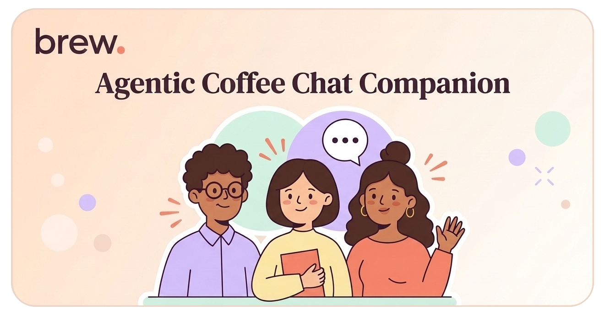
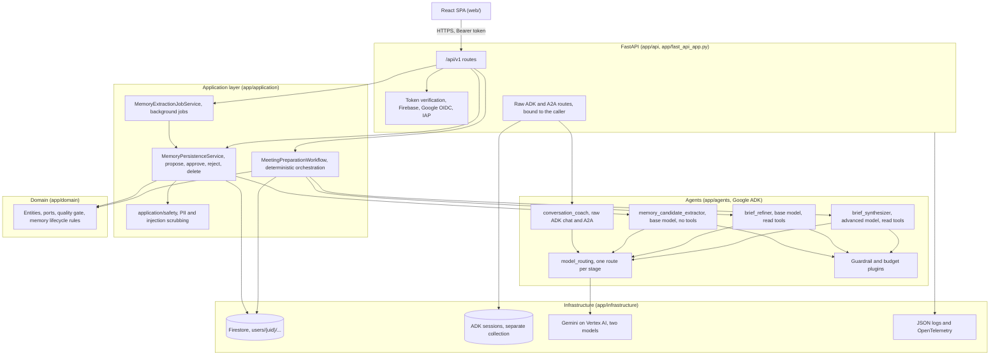

# Brew: AI-Powered Coffee Chat Buddy

Brew helps professionals prepare for coffee chats, networking meetings, mentorship conversations and customer discovery calls. It writes a time-boxed preparation brief, refines it on request, and after the meeting turns your notes into candidate memories that you approve, edit or reject. Approved memories ground the next brief for the same person.



## What it does

| Step | User action | What the system does |
| :--- | :--- | :--- |
| Prepare | Pick a person, state the objective, length and tone | Assembles saved context, calls the `brief_synthesizer` specialist on the advanced model, validates the brief, stores version 1 |
| Refine | "Make it 15 minutes", "warmer openers" | The `brief_refiner` specialist produces a new immutable version with an optimistic version check |
| Debrief | Paste post-meeting notes | Returns at once, extracts candidate memories in a background job, and stages them as `pending` |
| Review | Approve, edit, reject | Only an explicit approval creates a durable memory |
| Recall | Prepare the next meeting | Active approved memories for that person and your preferences are included |
| Govern | Open the Relationship Journal | Inspect, edit or delete any memory |

## Architecture



Layering rules:

- `app/domain` is pure Python and Pydantic. It imports no ADK, Firestore or FastAPI code.
- `app/application` holds use cases and depends only on the domain.
- `app/agents` holds everything ADK: agents, prompts, model routing, tools and plugins. `app/agent.py` is its thin entry point.
- `app/infrastructure` implements the ports (`firestore`, `inmemory`, `stubs`, `identity`, telemetry).
- `app/composition` wires adapters into the service container.
- `app/api` is the HTTP surface (`routers`, `schemas`, `middleware`). `app/fast_api_app.py` is its thin entry point.

Domain, application, infrastructure and API are each split by bounded context (`identity`, `contacts`, `meetings`, `memory`, `briefs`, plus `shared`). [`tests/unit/test_architecture_boundaries.py`](tests/unit/test_architecture_boundaries.py) enforces the import rules. See ADR-024 in [`docs/DECISIONS.md`](docs/DECISIONS.md).

All user data is partitioned per authenticated user under `users/{uid}/...` in Firestore. ADK session events live in a separate root collection.

## Agent design

Brew has four ADK agents, each with one job, behind a deterministic Python orchestrator. It is not an ADK multi-agent graph.

| Component | Kind | Role |
| :--- | :--- | :--- |
| `brief_synthesizer` ([`app/agents/brief_specialists.py`](app/agents/brief_specialists.py)) | ADK `LlmAgent`, read tools | Writes the first draft of a brief. Runs on the advanced model. |
| `brief_refiner` (same module) | ADK `LlmAgent`, read tools | Applies one revision instruction to an existing brief. |
| `conversation_coach` ([`app/agents/coach.py`](app/agents/coach.py)) | ADK `LlmAgent`, all four tools | Serves the raw ADK chat and A2A surface. Not used by the web app. |
| `memory_candidate_extractor` ([`app/agents/memory_extractor.py`](app/agents/memory_extractor.py)) | ADK `LlmAgent`, zero tools | Turns scrubbed notes into candidate memories as JSON. Holds no write access. |
| `MeetingPreparationWorkflow` ([`app/application/briefs/`](app/application/briefs/)) | Plain Python | Assembles context, calls the right specialist, validates output, allows one corrective regeneration, persists the brief. |
| `MemoryExtractionJobService` ([`app/application/memory/jobs.py`](app/application/memory/jobs.py)) | Plain Python | Accepts notes, returns a job at once, runs the extractor in the background, reports status. |
| `ConversationCoachGuardrailPlugin`, `WorkflowSafeguardPlugin` ([`app/agents/plugins`](app/agents/plugins)) | ADK plugins | Block identity arguments, reinforce the untrusted-data boundary, enforce model and tool budgets, emit intent and outcome logs. |

**Tools** ([`app/agents/tools/registry.py`](app/agents/tools/registry.py))

| Tool | Access | Purpose |
| :--- | :--- | :--- |
| `get_user_preferences` | Read | Saved defaults and approved preference memories |
| `get_contact_context` | Read | An owned contact's profile and approved memories |
| `get_meeting_history` | Read | Recent meetings with sanitized note excerpts |
| `suggest_memory_candidates` | Stage only | Stages `pending` proposals. Not available on the brief path. |

Every tool takes the caller's identity from the session, validates input and output with Pydantic, applies a timeout, and returns a structured error with a recovery instruction instead of raising.

**Memory model**

- **Session context** is a fresh ADK session per brief attempt. Nothing carries over between requests.
- **Long-term memory** is the approved store in Firestore. A memory moves through `proposed`, `approved`, `rejected`, `superseded` and `deleted`.
- **Writes need a person.** Agents can only stage proposals. `POST /api/v1/memories/{id}/approve` is the only path to a durable memory, and it supersedes an older memory only when the user was shown that target.
- **Only active approved memories reach a prompt.**

**Bounds on a brief request:** six model calls, one corrective regeneration, 60 seconds per attempt, and a deterministic quality gate before anything is saved.

**Model routing** ([`app/agents/model_routing.py`](app/agents/model_routing.py))

| Stage | Agent | Setting | Default |
| :--- | :--- | :--- | :--- |
| Brief synthesis | `brief_synthesizer` | `BREW_SYNTHESIS_MODEL` | `gemini-4-hydrogen` |
| Brief refinement | `brief_refiner` | `BREW_REFINEMENT_MODEL` | `GEMINI_MODEL` |
| Memory extraction | `memory_candidate_extractor` | `BREW_MEMORY_EXTRACTION_MODEL` | `GEMINI_MODEL` |
| Conversation and history summarization | `conversation_coach` | `GEMINI_MODEL` | `gemini-3.8-flash` |

Synthesis is the one step that weighs every constraint together, so it alone uses the advanced model: one call per new brief, or two if the quality gate forces the single regeneration.

**Background memory extraction.** `POST /api/v1/memories/extraction-jobs` returns 202 with a job and the client polls `GET /api/v1/memories/extraction-jobs/{id}`. The job never stores the notes and only stages `pending` proposals.

**Not built yet:** an ADK workflow graph or `SequentialAgent`, Terraform, a queue-backed job runner, and transactional approval. See [`docs/DECISIONS.md`](docs/DECISIONS.md) and [`docs/DEPLOYMENT.md`](docs/DEPLOYMENT.md) for current trade-offs and operational guidance.

## Prerequisites

- **Python 3.12+** and **[uv](https://docs.astral.sh/uv/)**
- **Node.js 22 LTS** and **npm**
- **Google Cloud SDK (`gcloud`)** and **`google-agents-cli` (`agents-cli`)**

## Quickstart

1. **Configure local environment variables.** The defaults run fully offline with in-memory storage.
   ```bash
   cp .env.example .env
   ```

2. **Install dependencies.**
   ```bash
   uv sync
   npm --prefix web install
   ```

3. **Start the backend and frontend.**
   ```bash
   uv run brew-dev
   # or: make dev
   ```
   - Frontend dev server: `http://127.0.0.1:5173` (proxies `/api/*` to FastAPI)
   - Backend health check: `http://127.0.0.1:8000/api/health`
   - A2A agent card: `http://127.0.0.1:8000/a2a/app/.well-known/agent-card.json`

## Quality gates

```bash
# Lint and format check
uv run ruff check .
uv run ruff format --check .
npm --prefix web run lint

# Static type checking
uv run mypy app tests/unit tests/integration
npm --prefix web run typecheck

# Unit and integration tests
uv run pytest
npm --prefix web test

# Production frontend build
npm --prefix web run build
```

`make check` runs all of the above.

Six integration tests need the Cloud Firestore emulator and error at setup without it:

```bash
gcloud components install cloud-firestore-emulator beta
gcloud beta emulators firestore start --host-port=127.0.0.1:8085 &
FIRESTORE_EMULATOR_HOST=127.0.0.1:8085 uv run pytest tests/integration -v
```

Tests never read your `.env` backends: [`tests/conftest.py`](tests/conftest.py) pins in-memory storage for the session. The last recorded run is in [`docs/TEST_RESULTS.md`](docs/TEST_RESULTS.md).

## Agent evaluation

```bash
# Scripted model, 120 scenarios. A smoke test of tools, guardrails and fault injection.
make eval-deterministic

# Live model on Vertex AI (requires Google Cloud credentials)
make eval-smoke   # 15 stratified scenarios
make eval         # all 120 scenarios
```

The scripted run uses a stand-in model that reads each scenario's expectations, so treat it as plumbing coverage and the live run as the quality signal. A separate test proves the metrics fail a deliberately bad agent. The live judge runs on `BREW_EVAL_JUDGE_MODEL` (default `gemini-4-hydrogen`), not on the model under test, and each run writes a `run_metadata.json` with the commit and model ids. Datasets and metrics are in [`tests/eval`](tests/eval).

Other `agents-cli` commands:

```bash
agents-cli info        # inspect the ADK project configuration
agents-cli playground  # interactive ADK web playground
```

## Container build and deployment

The multistage `Dockerfile` compiles `web/dist` and serves the SPA and the API on `$PORT` (default `8080`):

```bash
docker build -t brew:local .
docker run --rm -p 8080:8080 -e PORT=8080 brew:local
```

Cloud Run provisioning is scripted in [`gcloud_setup.sh`](gcloud_setup.sh) and [`iap_setup.sh`](iap_setup.sh). Both support `--dry-run`. See [`docs/DEPLOYMENT.md`](docs/DEPLOYMENT.md) for IAM, Workload Identity Federation, probes, rollback and cleanup.

```bash
PROJECT_ID="your-gcp-project-id" GITHUB_REPO="your-org/brew" ENABLE_IAP="true" ./gcloud_setup.sh --dry-run
```

Set `BREW_PERSISTENCE_BACKEND=firestore` on any deployed service. The default is in-memory, and a deployed service on in-memory storage fails `/readyz` unless `BREW_ALLOW_EPHEMERAL_PERSISTENCE=true` is set on purpose.

Background memory extraction runs inside the serving instance. On Cloud Run, deploy with `CLOUD_RUN_MIN_INSTANCES=1` so CPU stays allocated between requests. See [`docs/DEPLOYMENT.md`](docs/DEPLOYMENT.md) section 4.2.1.

## Documentation

| Document | Contents |
| :--- | :--- |
| [`docs/ARCHITECTURE.md`](docs/ARCHITECTURE.md) | Layering, data model, security and deployment |
| [`docs/DECISIONS.md`](docs/DECISIONS.md) | Architecture decision records |
| [`docs/OBSERVABILITY.md`](docs/OBSERVABILITY.md) | Spans, log fields and trace queries |
| [`docs/DEPLOYMENT.md`](docs/DEPLOYMENT.md) | Provisioning and CI/CD |
| [`docs/TEST_RESULTS.md`](docs/TEST_RESULTS.md) | Recorded quality-gate run and what could not be run |
| [`docs/PRD.md`](docs/PRD.md), [`docs/DESIGN.md`](docs/DESIGN.md) | Product scope and the design system |
| [`AGENTS.md`](AGENTS.md) | Engineering rules for contributors and coding agents |
