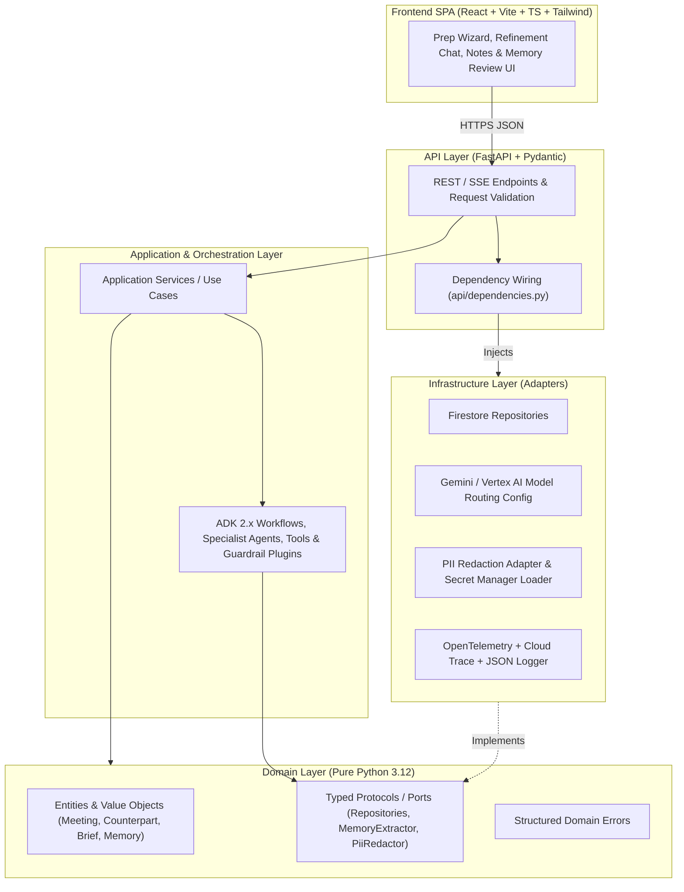

# System Architecture — Brew

**Status:** Baseline Architecture v1.0  
**Last Updated:** 2026-11-22

---

## 1. Architectural Goals & Principles

Brew is engineered around clean, explicit dependency boundaries so domain behavior remains easy to reason about, fast to unit-test, and resilient to SDK or infrastructure evolution:

1. **Domain Independence (Ports & Adapters)**: Core domain entities, value objects, invariants, and repository/service protocols (`domain/`) have **zero imports** from `google.adk`, `google.cloud.firestore`, `fastapi`, or `google.genai`.
2. **High Cohesion, Low Coupling**: Each module owns a single, well-defined responsibility—prep brief domain rules, ADK orchestration workflows, Firestore persistence adapters, and HTTP transport live in separate layers connected via typed interfaces.
3. **Explicit Dependency Injection**: External collaborators (repositories, ADK runner, PII redactor, secret provider, clock, tracer) are wired at integration boundaries (`api/dependencies.py` and CLI entrypoints), never instantiated as hidden module-level singletons inside business logic.
4. **Fail-Safe External Boundaries**: All calls to Gemini, Firestore, Secret Manager, and redaction services enforce explicit timeouts, structured error translation, and graceful degradation.

---

## 2. Layered Dependency Rules



**Strict Import Matrix:**

Each layer is split by bounded context (`shared`, `identity`, `contacts`, `meetings`, `memory`, `briefs`). The rules below are enforced by [`tests/unit/test_architecture_boundaries.py`](../tests/unit/test_architecture_boundaries.py). See ADR-024.

| Source Package | Allowed Internal Imports | Forbidden Imports |
| :--- | :--- | :--- |
| `app.domain` | Python stdlib, `pydantic` (pure value/schema types only). A context may import only contexts earlier in the order `shared`, `identity`, `contacts`, `meetings`, `memory`, `briefs`. | `fastapi`, `google.adk`, `google.genai`, `google.cloud.*`, `app.application`, `app.agents`, `app.infrastructure`, `app.composition`, `app.api` |
| `app.application` | `app.domain`, `opentelemetry.*` (span and log helpers in `application/shared/telemetry.py`) | `fastapi`, `google.adk`, `google.genai`, `google.cloud.*`, `app.agents`, `app.infrastructure`, `app.composition`, `app.api` |
| `app.agents` / `app.agent` | `app.domain`, `app.application`, `app.config`, `google.adk`, `google.genai`, `opentelemetry.*`, `pydantic` | `fastapi`, `google.cloud.*` (tools reach data only through capability-restricted ports) |
| `app.infrastructure` | `app.domain`, `app.application`, `app.config`, `google.cloud.*`, `google.auth`, `opentelemetry.*`. `google.adk` only in `sessions.py` and `observability.py`. | `fastapi`, `google.genai` |
| `app.composition` | `app.domain`, `app.infrastructure`, `app.agents`, `app.config` | `fastapi` |
| `app.api` / `app.fast_api_app` | Everything above, plus `fastapi` | None (HTTP entry point) |

Further rules from the same test file:

- `fastapi` is imported only under `app/api/`, `app/fast_api_app.py` and `app/app_utils/`. `google.genai` is imported only under `app/agents/`.
- `app/infrastructure/stubs/` (scripted stand-ins for models and identity) is imported only by `app/composition/` and the mock-identity adapters in `app/infrastructure/identity/`.
- No module imports an underscore-prefixed name from another module.

Known exceptions, left in place because removing them changes wiring rather than layout:

- `app/agents/` imports `build_adk_telemetry_config` and `SystemUtcClock` from `app/infrastructure/`.
- `app/agents/tools/dependencies.py` lazily imports `app.composition.builders` as a fallback when a tool runs with no injected dependencies (the standalone ADK CLI).
- `app/infrastructure/stubs/eval_fixtures.py` imports the `ServiceContainer` type from `app/composition/`.

---

## 3. Repository Layout

Brew keeps the project directly at the repository root (preserving `agents-cli-manifest.yaml` compatibility) with the React frontend in `web/`:

```text
brew/
├── AGENTS.md                        # Permanent engineering rules & working agreement
├── .agents/skills/                  # Project-scoped agent skills (e.g., generate-illustration)
├── agents-cli-manifest.yaml         # Official google-agents-cli project manifest
├── pyproject.toml                   # Python 3.12, uv, ruff, strict mypy, pytest config
├── uv.lock                          # Locked Python dependency graph
├── Dockerfile                       # Multistage Node 22 + Python 3.12 Cloud Run image ($PORT)
├── Makefile                         # Developer task shortcuts (make dev, make check, etc.)
├── .env.example                     # Safe placeholder environment variables
├── .editorconfig                    # Workspace formatting rules
├── docs/
│   ├── PRD.md                       # Product scope, user journey, non-goals
│   ├── ARCHITECTURE.md              # System architecture & boundaries
│   ├── DESIGN.md                    # Playful Social Club design tokens, components, & SVG art direction
│   ├── OBSERVABILITY.md             # OpenTelemetry, Cloud Trace, privacy, & log correlation runbooks
│   ├── DEPLOYMENT.md                # Cloud Run, IAP, Workload Identity Federation, & CI/CD runbook
│   ├── DECISIONS.md                 # Architectural Decision Records (ADRs)
│   └── openapi.json                 # Generated OpenAPI 3.1 HTTP API contract
├── app/
│   ├── config.py                    # Validated AppSettings (default model: gemini-3.8-flash)
│   ├── agent.py                     # Thin ADK entry point: root_agent and App registration
│   ├── fast_api_app.py              # Thin HTTP entry point: loads .env, exposes create_app and app
│   ├── server.py                    # Production uvicorn entrypoint honoring $PORT
│   ├── dev_runner.py                # Single-command local launcher (API + Vite)
│   ├── app_utils/                   # Scaffolded ADK shared session/artifact & A2A helpers
│   ├── domain/                      # Pure Pydantic v2 models, types, ports and rules, per context
│   │   ├── shared/                  # Base model, clock and id ports, errors, health
│   │   ├── identity/                # AuthenticatedPrincipal, authenticator port
│   │   ├── contacts/                # Contact model, types, repository port
│   │   ├── meetings/                # Meeting model, types, repository port
│   │   ├── memory/                  # Memory and proposal models, lifecycle rules, jobs, ports
│   │   └── briefs/                  # Brief models, context budget, workflow diagnostics, ports
│   │       └── quality/             # Deterministic quality gate, one rule family per file
│   ├── application/                 # Use cases, per context, depending only on the domain
│   │   ├── shared/                  # Telemetry helpers, correlation ids, validation, ownership
│   │   ├── safety/                  # PII redaction, untrusted-text sanitization
│   │   ├── health/                  # Liveness and readiness use case
│   │   ├── contacts/  meetings/     # Contact and meeting services
│   │   ├── memory/                  # Candidate staging, proposals, review, retrieval, jobs
│   │   ├── briefs/                  # MeetingPreparationWorkflow and its collaborators
│   │   └── coaching/                # Read-only queries and capability facades used by tools
│   ├── agents/                      # Everything that imports google.adk or google.genai
│   │   ├── coach.py                 # conversation_coach agent and ADK App
│   │   ├── brief_specialists.py     # brief_synthesizer and brief_refiner adapter
│   │   ├── memory_extractor.py      # memory_candidate_extractor adapter
│   │   ├── prompts.py               # Versioned instructions
│   │   ├── model_routing.py         # Per-stage model selection
│   │   ├── tools/                   # Contracts, handlers, error mapping, registry
│   │   └── plugins/                 # Coach guardrails, workflow safeguards
│   ├── infrastructure/              # Adapters behind the domain ports
│   │   ├── firestore/               # One repository per collection, shared operations
│   │   ├── inmemory/                # In-memory repositories for local runs and tests
│   │   ├── stubs/                   # Scripted model and identity stand-ins, eval fixtures
│   │   ├── identity/                # Verified tokens, mock sessions, runtime authenticator
│   │   └── *.py                     # Observability, ADK session factory, background jobs, clock, ids
│   ├── composition/                 # ServiceContainer and the builders that wire adapters
│   └── api/                         # FastAPI surface
│       ├── routers/                 # One router per context under /api/v1
│       ├── schemas/                 # Request and response models per context
│       ├── middleware/              # Request tracing, ADK surface authorization
│       └── *.py                     # App factory, auth, dependencies, errors, health, OpenAPI, SPA
├── tests/
│   ├── unit/                        # Fast isolated unit & architectural boundary tests
│   ├── integration/                 # Deterministic FastAPI, A2A card, & SPA serving tests
│   └── eval/                        # google-agents-cli evaluation config, judge, & datasets
└── web/
    ├── package.json                 # React 19, Vite, strict TypeScript, Tailwind CSS v4, Lucide, Vitest
    ├── package-lock.json            # Locked frontend dependency graph
    └── src/
        ├── index.css                # Centralized Playful Social Club CSS variables & Tailwind @theme tokens
        ├── assets/illustrations/    # Cohesive flat-vector character illustrations (chat-setup-hero.png + companion SVGs)
        ├── api/                     # 1:1 OpenAPI types & same-origin BrewApiClient with timeouts
        ├── auth/                    # Session storage, expiry detection, & Firebase/Google OIDC
        ├── components/
        │   ├── ui/                  # 15 reusable accessible UI primitives (BrewLogo, AppHeader, BottomNavigation, etc.)
        │   ├── domain/              # Domain cards (MeetingCard, QuestionCard, MemoryCard)
        │   └── screens/             # 5 responsive main screens (Home, Chats, People, Memory, Me)
        ├── test/                    # Vitest + React Testing Library setup
        ├── App.tsx                  # Shared shell, 5-tab BottomNavigation, & focused creation flows
        ├── App.test.tsx             # End-to-end UX, validation, API error, & auth expiry tests
        ├── DesignSystemAndShell.test.tsx # Wordmark, SVG illustration, focused flow, & profile default tests
        └── TestPyramidJourneys.test.tsx  # Multi-counterpart, timeout, memory governance, & revision tests
```

---

## 4. ADK 2.x Multi-Agent & Workflow Architecture

> [!IMPORTANT]
> **Implementation status (2026-11-25).** Sections 4.1 to 4.3 describe the original target design. What runs today differs in names and shape:
> - **Specialist agents.** `brief_synthesizer` writes the first draft and `brief_refiner` applies one revision. Both are ADK `LlmAgent`s built in [`app/agents/brief_specialists.py`](../app/agents/brief_specialists.py) with instructions from [`app/agents/prompts.py`](../app/agents/prompts.py), request prompts from [`app/agents/brief_prompts.py`](../app/agents/brief_prompts.py) and three read-only tools. `memory_candidate_extractor` has no tools. `conversation_coach` ([`app/agent.py`](../app/agent.py)) serves the raw ADK chat and A2A surface.
> - **Model routing.** [`app/agents/model_routing.py`](../app/agents/model_routing.py) routes synthesis to `BREW_SYNTHESIS_MODEL` (default `gemini-4-hydrogen`) and everything else to `GEMINI_MODEL` (default `gemini-3.8-flash`) unless a stage override is set. See ADR-021.
> - **Orchestration.** A deterministic Python class, `MeetingPreparationWorkflow` ([`app/application/briefs/`](../app/application/briefs/)), assembles context, calls the specialist, validates its JSON, and allows one corrective regeneration. There is no `BrewCoordinatorWorkflow`, `ContextAssemblerNode`, ADK workflow graph or `output_schema`. Each attempt uses a fresh in-memory ADK session, so refinement history compaction does not apply on this path.
> - **Background extraction.** `POST /api/v1/memories/extraction-jobs` returns 202 and the extractor runs as a background job. See ADR-022.
> - **Plugins.** `ConversationCoachGuardrailPlugin` and `WorkflowSafeguardPlugin` stand in for the `BrewGuardrailPlugin` named below.
>
> Section 4.4 (tool contract) is accurate. See the current agent design in [`README.md`](../README.md) and ADRs 021–025 in [`DECISIONS.md`](DECISIONS.md).

Rather than using a monolithic single-agent prompt, Brew decomposes agentic responsibilities across specialized ADK 2.x components with **strategic model routing**, **explicit JSON schemas**, **runner-wide safety plugins**, and **Human-in-the-Loop memory approval**.

### 4.1 Agent Roster & Model Routing

| Agent / Node | ADK Pattern | Model Tier | Responsibility |
| :--- | :--- | :--- | :--- |
| `BrewCoordinatorWorkflow` | ADK 2.x `Workflow` / Coordinator | Deterministic router + stage edges | Routes session actions (`generate_brief`, `refine_brief`, `extract_memories`) across validated typed state. |
| `ContextAssemblerNode` | Function / Tool stage | Deterministic + Firestore Port | Executes `retrieve_counterpart_memories` and `retrieve_user_preferences`, applying token budget & history compaction before LLM invocation. |
| `BriefSynthesizerAgent` | `LlmAgent` (`output_schema=PreparationBriefSchema`) | **Gemini Pro** | High-reasoning initial synthesis combining counterpart profile, purpose/duration/tone constraints, and prior approved memories into a structured time-boxed brief. |
| `BriefRefinerAgent` | `LlmAgent` (`output_schema=PreparationBriefSchema`) | **Gemini Flash** | Low-latency conversational refinement updating targeted sections of the current brief while preserving invariants. |
| `MemoryExtractorAgent` (`memory_candidate_extractor`) | ADK `Agent` (`AdkMemoryProposalAdapter` in `app/agents/memory_extractor.py`, zero tools / zero DB write handles) | **Configured Gemini Model** | Analyzes PII-scrubbed user meeting notes, preserves epistemic attribution (`user_reported_observation` / `user_stated_preference`) and source excerpts, filters sensitive third-party assumptions, skips duplicates, and tags contradictions (`supersedes_memory_id`) for human review. |
| `BrewGuardrailPlugin` | ADK `BasePlugin` (Runner-wide) | Policy + PII + Audit hooks | Intercepts `before_model`, `after_model`, `before_tool`, and `after_tool` across every sub-agent for PII redaction, prompt-injection defense, and Intent-vs-Outcome structured logging. |

### 4.2 Core Sequence: Preparation, Refinement, Async Memory & HITL Approval

```mermaid
sequenceDiagram
    autonumber
    actor User
    participant SPA as React SPA
    participant API as FastAPI Backend
    participant WF as ADK 2.x Workflow & Guardrail Plugin
    participant Pro as BriefSynthesizer (Gemini Pro)
    participant Flash as Refiner / Extractor (Gemini Flash)
    participant DB as Firestore (via Ports)

    User->>SPA: Create counterpart + enter purpose, duration, tone
    SPA->>API: POST /api/v1/contacts & POST /api/v1/briefs/generate
    API->>DB: Fetch approved counterpart & user preference memories
    API->>WF: Run generate_brief stage (compacted context)
    WF->>Pro: Generate structured brief (strict JSON schema)
    Pro-->>WF: PreparationBrief payload
    WF->>DB: Persist Meeting & PreparationBrief (v1)
    API-->>SPA: 201 Created (PreparationBrief)

    User->>SPA: "Make openers warmer and trim to 20 mins"
    SPA->>API: POST /api/v1/briefs/{id}/revise (expected_version)
    API->>WF: Run refine_brief stage (compacted history + active brief)
    WF->>Flash: Refine brief (Gemini Flash)
    Flash-->>WF: Updated PreparationBrief
    WF->>DB: Save updated brief (v2) with optimistic concurrency check
    API-->>SPA: 200 OK (Updated PreparationBrief)

    User->>SPA: Submit post-meeting notes for memory extraction
    SPA->>API: POST /api/v1/memories/propose
    API->>WF: Scrub PII & extract MemoryProposal candidates
    WF->>Flash: Propose MemoryProposal list
    Flash-->>WF: ProposedMemoryCandidate list
    WF->>DB: Store MemoryProposal items in separate proposal store (status = pending)
    API-->>SPA: 201 Created (MemoryProposalBatchResponse)

    User->>SPA: Review, optionally edit, and approve proposal
    SPA->>API: POST /api/v1/memories/{id}/approve (expected_version)
    API->>DB: Mark proposal approved; create durable Memory in approved store
    API-->>SPA: 200 OK (MemoryResponse)
```

### 4.3 Context Management & History Compaction
- **Sliding Window + Structured Summary Compaction**: During multi-turn natural-language brief refinement, Brew retains the active `PreparationBrief` state plus the most recent $N$ verbatim turns, compacting older refinement turns into a concise `RefinementHistorySummary` once token or turn thresholds are exceeded.
- **Bounded Memory Injection**: When starting a new session, only top-ranked approved memories for the target counterpart and active global user preferences (bounded by a strict token budget) are injected into the prompt context.

### 4.4 Tool Interface, Security Isolation, & Guided Error Contract
Every ADK tool exposed to `conversation_coach` (`app/agents/tools/registry.py`):
1. Uses a specific action name (`get_user_preferences`, `get_contact_context`, `get_meeting_history`, `suggest_memory_candidates`).
2. Resolves caller identity strictly from `ToolContext.user_id`—no tool schema accepts `user_id` or `owner_user_id`, and `ConversationCoachGuardrailPlugin` (`app/agents/plugins/coach_guardrails.py`) blocks any injected identity-override keys with `IDENTITY_OVERRIDE_FORBIDDEN`.
3. Operates strictly through capability-restricted read/staging facades (`ReadOnlyPreferencesFacade`, `ReadOnlyContactFacade`, `ReadOnlyMeetingFacade`, `ReadOnlyApprovedMemoryFacade`, `PendingProposalOnlyFacade` in `app/application/coaching/queries.py`) so the agent never holds unrestricted database write, delete, or approval handles.
4. Enforces `asyncio.wait_for` I/O timeouts, OpenTelemetry spans (`coach.tool.*`), PII redaction, and prompt-injection clause stripping (`app/application/safety/`), tagging all returned payloads with `data_trust_level="untrusted_user_data"`.
5. Never raises unhandled operational exceptions into the LLM loop; on recoverable failures (validation error, missing entity, cross-user `FORBIDDEN`, timeout, or backend outage), returns a typed response with `status="error"`, `error.code`, `error.retryable`, and `error.recovery_instruction`.

---

## 5. Domain & Persistence Data Model (Firestore)

All domain Firestore documents are strictly partitioned per authenticated user (`users/{uid}/...`) and mapped to pure Pydantic v2 domain models inside `app/infrastructure/firestore/` using non-blocking `firestore.AsyncClient` and `@firestore.async_transactional`:

- **`users/{uid}/preferences/default`**: User coaching defaults (`default_tone`, `default_duration_minutes`, `preferred_question_count`, `communication_style_notes`, `focus_areas`, `version`).
- **`users/{uid}/contacts/{contactId}`**: Counterpart metadata (`name`, `title`, `role`, `organization`, `context_notes`, `version`).
- **`users/{uid}/meetings/{meetingId}`**: Meeting configuration (`contact_id`, `purpose`, `tone`, `objective`, `duration_minutes`, `scheduled_at`, `notes`, `status`, `latest_brief_id`, `version`).
- **`users/{uid}/briefs/{briefId}`**: Versioned `PreparationBrief` entities (`meeting_id`, `contact_id`, `contact_context`, `meeting_objective`, `conversation_openers`, `time_boxed_agenda`, `suggested_questions`, `suggested_follow_up_topics`, `referenced_memory_ids`, `version`), paired with atomic immutable revision snapshots at **`users/{uid}/briefs/{briefId}/revisions/v{version}`** so prior versions are never silently overwritten.
- **`users/{uid}/workflowIdempotency/{operation}:{key}`**: Per-user workflow deduplication records binding `Idempotency-Key` values and canonical payload fingerprints to persisted brief versions.
- **`users/{uid}/memories/{memoryId}`**: Consented, durable `Memory` entities (`scope`, `contact_id`, `memory_type`, `text`, `source` provenance, `consent_status`, `lifecycle_state` in `approved`/`superseded`, `epistemic_status`, `supersedes_memory_id`, `superseded_by_memory_id`, `superseded_at`, `version`). Only active (`lifecycle_state == "approved"`) records participate in prompt/tool recall unless `include_superseded=true` is requested explicitly for audit inspection.
- **`users/{uid}/deletedMemories/{memoryId}`**: Immutable `deleted` lifecycle tombstones (`lifecycle_state="deleted"`, `deleted_at`, preserved `source` provenance and timestamps) written atomically in the same `@firestore.async_transactional` batch that removes the active document from `users/{uid}/memories/{memoryId}`.
- **`users/{uid}/memoryProposals/{proposalId}`**: Separate staged/reviewed `MemoryProposal` entities (`status`, `lifecycle_state` in `proposed`/`approved`/`rejected`, `epistemic_status`, `supersedes_memory_id`, `conflict_summary`, `rejection_reason`, `approved_memory_id`, `source`, `version`) strictly isolated from `memories`.
- **Isolated ADK Session Storage (`adk-session`, `app_states`, `user_states`)**: Managed via the official `google.adk.integrations.firestore.firestore_session_service.FirestoreSessionService` constructed by `SessionServiceFactory` (`app/infrastructure/sessions.py`), strictly separated from `users/{uid}/...` domain collections.

---

## 6. Observability, Tracing, and Privacy Pipeline

See [`docs/OBSERVABILITY.md`](OBSERVABILITY.md) for complete operational runbooks, span hierarchies, Cloud Trace filters, and log correlation queries.

1. **Distributed Tracing (OpenTelemetry + Cloud Trace)**:
   - Incoming HTTP requests extract W3C `traceparent` or Google Cloud `X-Cloud-Trace-Context` headers, open a root `SpanKind.SERVER` span (`{METHOD} {ROUTE}`), and return `X-Request-ID` + `X-Trace-ID` headers.
   - Non-duplicating child spans cover workflow orchestration (`brew.workflow.*`), pre-brief context & memory retrieval (`brew.context.retrieve`, `brew.memory.retrieve`), ADK built-in spans (`invoke_workflow`, `invoke_agent`, `generate_content` with token usage, `execute_tool` enriched with Brew error classifications), deterministic schema/quality validation (`brew.output.validate`), single corrective regeneration (`brew.workflow.corrective_regeneration`), HITL memory approval (`brew.memory.propose`, `brew.memory.approve`), and Firestore operations (`firestore.<collection>.<op>`).
2. **Privacy-by-Default Telemetry Lockdown**:
   - Prompt/response content capture (`OTEL_INSTRUMENTATION_GENAI_CAPTURE_MESSAGE_CONTENT=NO_CONTENT`, `ADK_CAPTURE_MESSAGE_CONTENT_IN_SPANS=false`, `TelemetryConfig(capture_message_content=ContentCapturingMode.NO_CONTENT)`) and completion upload hooks (`OTEL_INSTRUMENTATION_GENAI_COMPLETION_HOOK`) are disabled by default unless explicitly authorized via `BREW_TELEMETRY_CAPTURE_CONTENT=true` / `BREW_TELEMETRY_UPLOAD_COMPLETIONS=true`.
   - `FORBIDDEN_TELEMETRY_KEYS` and `scrub_sensitive_telemetry_text` (`app/application/shared/telemetry.py`) prevent raw contact notes, private biographies, prompts, credentials, JWTs, API keys, emails, SSNs, and phone numbers from entering span attributes or logs.
3. **Structured JSON Logging & Intent-vs-Outcome Capture**:
   - All `app.*` and `google_adk.*` logs emit single-line JSON structured for Cloud Logging (`severity`, `message`, `logging.googleapis.com/trace`, `logging.googleapis.com/spanId`, `logging.googleapis.com/trace_sampled`, `trace_id`, `span_id`, `request_id`, `event_type`, `error_type`, `error_code`, `error_classification`).
   - `ConversationCoachGuardrailPlugin` and `WorkflowSafeguardPlugin` emit paired `*.intent` and `*.outcome` events across agent invocations, Gemini calls (including token counts), and tool calls.

---

## 7. Security, Cloud Run Deployment, and CI/CD

See [`docs/DEPLOYMENT.md`](DEPLOYMENT.md) for step-by-step Google Cloud provisioning, IAM roles, WIF configuration, rollback, cleanup, and billable resource analysis.

- **Single-Service Cloud Run Footprint (`gcloud_setup.sh` + `agents-cli deploy`)**: Deploys one private-by-default Cloud Run service (`1 vCPU`, `1Gi` RAM, concurrency `8`, `min-instances=0` scale-to-zero, `max-instances=5`, `120s` timeout) serving the compiled React SPA (`web/dist`), FastAPI `/api/v1/*` routes, A2A surface, and ADK `conversation_coach`, wired with `/readyz` startup/readiness probes and `/healthz` liveness probes.
- **Zero Static Keys & Least-Privilege IAM**: Runtime uses `brew-runtime@<PROJECT>.iam.gserviceaccount.com` via Application Default Credentials (`roles/aiplatform.user`, `roles/datastore.user`, `roles/logging.logWriter`, `roles/cloudtrace.agent`, `roles/monitoring.metricWriter`, plus secret-scoped `roles/secretmanager.secretAccessor`). CI/CD uses GitHub OIDC Workload Identity Federation (`brew-github-pool` -> `brew-cicd` SA) with zero service account JSON keys.
- **Private-by-Default + Defense-in-Depth Auth**: Supports Cloud Run Identity-Aware Proxy (`--iap` + cryptographic `X-Goog-IAP-JWT-Assertion` verification, plus [`iap_setup.sh`](../iap_setup.sh) for binding a separate custom IAP OAuth client alongside `GOOGLE_OAUTH_CLIENT_ID` in managed GCP orgs) and verified Google OAuth / Firebase ID tokens; blocks ADK's ungoverned `PATCH /apps/{app}/users/{uid}/memory` route (`401` / `403 UNGOVERNED_MEMORY_WRITE_DISABLED`) and enforces authenticated user ownership across `/api/v1/*`, `/apps/*`, `/run`, `/run_sse`, `/run_live`, and `POST /a2a/*`.
- **CI/CD Pipeline (`.github/workflows/`)**:
  1. **PR Quality Gates (`ci.yml`)**: Ruff lint/format, Codespell, strict `mypy`, `gcloud_setup.sh --dry-run` & `iap_setup.sh --dry-run`, Python unit tests, local Cloud Firestore Emulator integration tests, frontend ESLint + TypeScript + Vitest + production Vite build, and multistage Docker build + container smoke validation (with live-model evals kept off PRs by default).
  2. **Authorized Main Deployment (`deploy.yml`)**: Runs `ci.yml`, gates on `production` GitHub Environment authorization, authenticates via WIF, deploys via `agents-cli deploy`, executes authenticated `/healthz`, `/readyz`, SPA, and `/api/v1/auth/me` smoke tests, and publishes revision summaries.
  3. **Controlled Model Evaluation (`eval-controlled.yml`)**: Manual `workflow_dispatch` job (`smoke` or `comprehensive` 120-scenario `agents-cli eval` suite) gated behind the `model-evaluation` environment.
