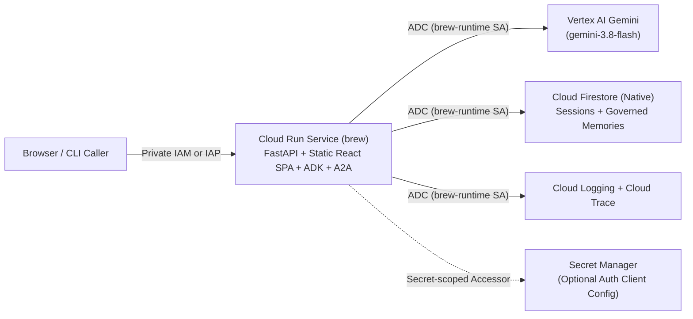

# Brew — Google Cloud Deployment Guide

This guide documents how to provision, deploy, verify, roll back, and tear down **Brew** on Google Cloud using the **smallest reasonable infrastructure footprint** via the `google-agents-cli` (`agents-cli`) Cloud Run deployment target.

---

## 1. Architecture & Footprint Summary

Brew deploys as **one private-by-default Cloud Run service** (`brew`) running a single container image built from the multistage [`Dockerfile`](../Dockerfile):



- **Unified Single Container**: Compiles `web/` (`npm ci && npm run build`) in Stage 1 and serves `web/dist` alongside `/api/v1/*`, `/api/auth/*`, `/a2a/app/*`, `/healthz`, `/readyz`, and ADK `conversation_coach` routes from a non-root Python 3.12 runtime (`uid=10001`).
- **Zero Static Keys**: Runtime uses the attached `brew-runtime` service account via Application Default Credentials (ADC). GitHub Actions CI/CD uses OIDC **Workload Identity Federation (WIF)**. Service account JSON keys are never created.
- **Private by Default + Defense-in-Depth Auth**:
  - Cloud Run deploys private (`--no-allow-unauthenticated`).
  - Browser access uses **Cloud Run Identity-Aware Proxy (`--iap`)** (recommended zero-trust perimeter) and/or verified **Google OAuth 2.0 / Firebase ID tokens**.
  - Even if an operator explicitly opts into public Cloud Run ingress (`ALLOW_PUBLIC_INGRESS=true`) so browsers can load the SPA directly, every `/api/v1/*` route and ADK runtime route (`/apps/*`, `/run`, `/run_sse`, `/run_live`, `POST /a2a/*`) enforces cryptographic user authentication, and ADK's ungoverned `PATCH /apps/{app}/users/{uid}/memory` endpoint is permanently blocked (`401` unauthenticated / `403 UNGOVERNED_MEMORY_WRITE_DISABLED` authenticated) so durable memories always require HITL approval.

---

## 2. Prerequisites

1. **Google Cloud Project** with billing enabled (e.g., `PROJECT_ID="brew-prod"`).
2. **Local Tooling**:
   - `gcloud` CLI (`>= 500.0.0`, with `beta` component installed)
   - `uv` (`>= 0.8.0`) and Python `3.12`
   - `agents-cli` (`uv tool install google-agents-cli==1.15.0`)
   - Node.js `22 LTS` & `npm` (for local builds; Cloud Build compiles `web/` automatically in the container)
   - `curl` and `git`
3. **Local Application Default Credentials (No JSON Keys)**:
   ```bash
   gcloud auth login
   gcloud auth application-default login
   gcloud config set project "${PROJECT_ID}"
   gcloud auth application-default set-quota-project "${PROJECT_ID}"
   ```
   Ensure `GOOGLE_APPLICATION_CREDENTIALS` is **unset** (`unset GOOGLE_APPLICATION_CREDENTIALS`); [`gcloud_setup.sh`](../gcloud_setup.sh) rejects static JSON key files.

---

## 3. Required IAM Permissions

### 3.1 Provisioning Operator (Running `gcloud_setup.sh` Once)
The human administrator or bootstrap Terraform principal running initial setup needs:
- `roles/serviceusage.serviceUsageAdmin` (enable Google Cloud APIs)
- `roles/iam.serviceAccountAdmin` & `roles/iam.workloadIdentityPoolAdmin` (create `brew-runtime`, `brew-cicd`, and WIF pool/provider)
- `roles/resourcemanager.projectIamAdmin` (bind least-privilege roles)
- `roles/datastore.owner` (create Firestore database and collection-group/composite indexes)
- `roles/artifactregistry.admin` (create `brew` Docker repository and retention policy)
- `roles/secretmanager.admin` (create secret containers and secret-level IAM bindings)
- `roles/run.admin` & `roles/cloudbuild.builds.editor` (initial Cloud Build & Cloud Run deploy)
- `roles/iap.admin`, `roles/iap.settingsAdmin`, & `roles/oauthconfig.editor` (when binding a custom OAuth client to Cloud Run IAP via [`iap_setup.sh`](../iap_setup.sh))

### 3.2 Runtime Identity (`brew-runtime@<PROJECT_ID>.iam.gserviceaccount.com`)
Attached to the Cloud Run revision and accessed strictly via ADC:

| Role | Scope | Purpose |
| :--- | :--- | :--- |
| `roles/aiplatform.user` | Project | Invoke Gemini (`gemini-3.8-flash`) via Vertex AI |
| `roles/datastore.user` | Project | Read/write per-user Firestore documents and isolated `adk-session` records |
| `roles/logging.logWriter` | Project | Emit structured JSON logs to Cloud Logging |
| `roles/cloudtrace.agent` | Project | Export OpenTelemetry trace spans to Cloud Trace |
| `roles/monitoring.metricWriter` | Project | Export OpenTelemetry runtime metrics |
| `roles/secretmanager.secretAccessor` | **Individual Secret(s) only** | Read `brew-google-oauth-client-id` / `brew-firebase-web-api-key` |

### 3.3 Keyless CI/CD Identity (`brew-cicd@<PROJECT_ID>.iam.gserviceaccount.com`)
Federated exclusively to `attribute.repository == "<OWNER>/<REPO>"` via Workload Identity Pool `brew-github-pool`:

| Role | Scope | Purpose |
| :--- | :--- | :--- |
| `roles/iam.workloadIdentityUser` | `brew-cicd` SA | Allow GitHub OIDC tokens from `<OWNER>/<REPO>` to impersonate `brew-cicd` |
| `roles/iam.serviceAccountUser` | **`brew-runtime` SA only** | Attach `brew-runtime` to deployed Cloud Run revisions (no project-wide SA impersonation) |
| `roles/iam.serviceAccountTokenCreator` | **`brew-cicd` SA only** | Mint short-lived OIDC ID tokens for post-deploy smoke tests |
| `roles/artifactregistry.writer` | Project | Push SHA-tagged container images |
| `roles/run.developer` | Project | Deploy Cloud Run revisions and configure probes |
| `roles/run.invoker` | Project | Execute authenticated post-deploy `/healthz`, `/readyz`, and `/api/v1/auth/me` smoke tests |
| `roles/aiplatform.user` | Project | Run manual controlled `eval-controlled.yml` live Gemini evaluations |

---

## 4. Configuration

### 4.1 Cloud Run Sizing, Scaling, & Probes
Configured by [`gcloud_setup.sh`](../gcloud_setup.sh) and [`.github/workflows/deploy.yml`](../.github/workflows/deploy.yml):

| Setting | Default | Rationale |
| :--- | :--- | :--- |
| `--cpu` | `1` | Single async `uvicorn` event loop; coaching requests are Gemini/Firestore I/O-bound |
| `--memory` | `1Gi` | Comfortably serves 8 concurrent JSON/SSE coaching requests with minimal footprint |
| `--concurrency` | `8` | Matches `agents-cli` sizing guidance to prevent per-turn context memory spikes |
| `--min-instances` | `0` | Scales to zero when idle (`$0` idle compute); set to `1` if zero cold-start latency is needed |
| `--max-instances` | `5` | Caps horizontal scale and protects downstream Vertex AI quota |
| `--timeout` | `120` | Covers `BREW_MODEL_WORKFLOW_TIMEOUT_SECONDS=60.0` + single corrective regeneration |
| Startup probe | `GET /readyz` (`:8080`) | `initialDelaySeconds=2, periodSeconds=5, timeoutSeconds=4, failureThreshold=6` |
| Readiness probe | `GET /readyz` (`:8080`) | Verifies ADK runner, Firestore repositories, and deployed auth provider before serving traffic |
| Liveness probe | `GET /healthz` (`:8080`) | Lightweight in-process check (`periodSeconds=30, timeoutSeconds=5, failureThreshold=3`) |

### 4.2 Environment Variables & Secret Manager
Non-sensitive configuration is passed via `--update-env-vars`:
- `APP_ENV=production`, `BREW_AUTH_MODE=verified` (hard-disables `local_mock` personas and `BREW_SEED_EVAL_FIXTURES`)
- `GOOGLE_GENAI_USE_ENTERPRISE=true`, `GOOGLE_CLOUD_PROJECT=<PROJECT_ID>`, `GOOGLE_CLOUD_LOCATION=global`, `GEMINI_MODEL=gemini-3.8-flash`
- `BREW_PERSISTENCE_BACKEND=firestore`, `FIRESTORE_DATABASE=(default)`, `BREW_SESSION_BACKEND=firestore`, `ADK_FIRESTORE_ROOT_COLLECTION=adk-session`
- `OTEL_TO_CLOUD=true`, `BREW_CLOUD_TRACE_ENABLED=true`, `OTEL_SERVICE_NAME=brew`
- Privacy defaults locked off: `OTEL_INSTRUMENTATION_GENAI_CAPTURE_MESSAGE_CONTENT=NO_CONTENT`, `ADK_CAPTURE_MESSAGE_CONTENT_IN_SPANS=false`, `BREW_TELEMETRY_CAPTURE_CONTENT=false`, `BREW_TELEMETRY_UPLOAD_COMPLETIONS=false`
- When `ENABLE_IAP=true`: `BREW_IAP_JWT_AUDIENCE=/projects/<PROJECT_NUMBER>/locations/<REGION>/services/brew`

Auth client credentials (`GOOGLE_OAUTH_CLIENT_ID`, optional `FIREBASE_WEB_API_KEY`) are stored in **Secret Manager** (`brew-google-oauth-client-id`, `brew-firebase-web-api-key`) and mounted via `--update-secrets`.

### 4.3 Browser Authentication Options
1. **Option A — Private Cloud Run + Identity-Aware Proxy (Recommended Default)**:
   - Cloud Run remains strictly private (`allUsers` is never granted `roles/run.invoker`); IAP authenticates the browser user at Google's edge and forwards a signed `X-Goog-IAP-JWT-Assertion` header (`iap:<subject>`).
   - **Standard Internal Workspace Org**: If your Google Workspace org allows unlisted internal IAP services and you sign into both IAP and Brew with the same org account, configure an **Internal** OAuth consent screen and deploy with `ENABLE_IAP=true` and `IAP_ACCESSOR_MEMBERS="user:you@yourdomain.com"`.
   - **Managed GCP Orgs (`iam.allowedPolicyMemberDomains`) & Dual-Account Sign-In**: If your org blocks Google's default internal IAP client (`"Your account is managed by an organization that has this service turned off for its users"` / `ServiceNotAllowed`), or you want to pass the IAP gate with your GCP org email and sign into Brew itself with a personal `@gmail.com` account, follow **Section 5.3 ([`iap_setup.sh`](../iap_setup.sh))** to bind two separate OAuth 2.0 Web Clients.
2. **Option B — Public Cloud Run SPA + Verified In-App Auth (Only When Org Policy Permits `allUsers`)**:
   - Create a Web OAuth 2.0 Client ID (`brew-web-spa`) in **APIs & Services -> Credentials** and add your `https://brew-...run.app` URLs under **Authorized JavaScript origins**.
   - Supply `GOOGLE_OAUTH_CLIENT_ID_VALUE` (and optional `FIREBASE_WEB_API_KEY_VALUE`) to `gcloud_setup.sh`.
   - Only if your GCP org does **not** block `allUsers` via `constraints/iam.allowedPolicyMemberDomains` and you intentionally set `ENABLE_IAP=false ALLOW_PUBLIC_INGRESS=true`, `gcloud_setup.sh` first verifies that auth secrets exist and confirms `POST /api/v1/memories/propose` and `PATCH /apps/app/users/probe/memory` reject unauthenticated requests (`401`) before binding `allUsers` `roles/run.invoker`.

---

## 5. Deployment Steps

### 5.1 Preview Ordered Setup Commands (Dry Run)
```bash
PROJECT_ID="your-gcp-project-id" \
REGION="asia-southeast1" \
GITHUB_REPO="your-org/brew" \
ENABLE_IAP="true" \
IAP_ACCESSOR_MEMBERS="user:you@example.com" \
./gcloud_setup.sh --dry-run
```

### 5.2 Provision Infrastructure & Deploy Initial Revision
```bash
PROJECT_ID="your-gcp-project-id" \
REGION="asia-southeast1" \
GITHUB_REPO="your-org/brew" \
ENABLE_IAP="true" \
IAP_ACCESSOR_MEMBERS="user:you@example.com" \
GOOGLE_OAUTH_CLIENT_ID_VALUE="123456789-web.apps.googleusercontent.com" \
./gcloud_setup.sh
```

`gcloud_setup.sh` executes in strict dependency order:
1. Enables bootstrap (`serviceusage`, `cloudresourcemanager`), IAM/Secrets, and runtime APIs (`firestore`, `aiplatform`, `artifactregistry`, `cloudbuild`, `run`, `logging`, `cloudtrace`, `monitoring`, `telemetry`, `iap`).
2. Creates the Native-mode Firestore database (`(default)`) with delete protection, configures the **6 required `COLLECTION_GROUP` field index exemptions** (`contacts.id`, `meetings.id`, `briefs.id`, `memoryProposals.id`, `memories.id`, `sessions.appName`), and creates composite indexes on `memories` and `memoryProposals`.
3. Creates `brew-runtime` SA with least-privilege runtime roles.
4. Creates `brew-cicd` SA and Workload Identity Pool/Provider (`brew-github-pool` / `brew-github-oidc`) scoped to `GITHUB_REPO`.
5. Creates Artifact Registry repo `brew` with a `keep-recent-10` cleanup policy.
6. Stores optional auth client IDs in Secret Manager and binds secret-level `roles/secretmanager.secretAccessor` to `brew-runtime`.
7. Builds the container image via Cloud Build and deploys to Cloud Run via `agents-cli deploy --no-agent-identity --service-account ...`.
8. Attaches `/readyz` startup/readiness probes and `/healthz` liveness probe, enforces private IAM, verifies unauthenticated memory writes fail (`401`/`403`), and runs an authenticated smoke check.

> **Note on Firestore Index Build Time:** Single-field `COLLECTION_GROUP` exemptions and composite indexes typically finish building within 1–3 minutes on an empty project. Check status anytime with:
> ```bash
> gcloud firestore indexes composite list --project="${PROJECT_ID}" --database="(default)"
> ```

### 5.3 Configure Custom Cloud Run IAP & Dual-Account Sign-In (`iap_setup.sh`)

In managed Google Cloud organizations (where `constraints/iam.allowedPolicyMemberDomains` blocks `allUsers` and `@gmail.com` in IAM, and Google Workspace blocks Cloud Run's default internal IAP OAuth client with `ServiceNotAllowed`), authentication operates across **two independent layers**:

| Layer | Purpose | OAuth 2.0 Web Client | Allowed Accounts |
| :--- | :--- | :--- | :--- |
| **Layer 1: Cloud Run IAP Edge** | Unlocks private `.run.app` ingress via IAP session cookie | **Client A (`brew-iap-edge`)** bound via `gcloud iap settings set` | **GCP org domain email only** (`roles/iap.httpsResourceAccessor`) |
| **Layer 2: Brew Web App UI** | Signs into Brew & scopes Firestore sessions/memories (`google:<sub>`) | **Client B (`brew-web-spa`)** stored in Secret Manager (`brew-google-oauth-client-id`) | **Any External Test User** (including personal `xx@gmail.com`) |

> **Why two separate Web Clients?** Cloud Run IAP inspects and consumes tokens issued to its own OAuth client (`brew-iap-edge`). Keeping `brew-web-spa` separate guarantees IAP passes Brew's `Authorization: Bearer` header untouched to FastAPI.

#### Step 1: Set OAuth Consent Screen to External (Testing) & Add Test Users
1. Open `https://console.cloud.google.com/auth/audience?project=<PROJECT_ID>` *(or **APIs & Services -> OAuth consent screen**)*.
2. Set **User Type** to **External** and keep Publishing status as **Testing**.
3. Under **Test users**, add **both**:
   - Your GCP organization email (`you@your-gcp-domain.com`) — used at **Layer 1 (IAP)**
   - Your personal Google account (`xx@gmail.com`) — used at **Layer 2 (Brew UI)**

#### Step 2: Run `./iap_setup.sh` and Create `brew-iap-edge`
Google Cloud retired `gcloud iap oauth-clients` in March 2026 and does not provide a CLI to create `*.apps.googleusercontent.com` Web Clients or edit JavaScript Origins / Redirect URIs, so [`iap_setup.sh`](../iap_setup.sh) discovers your URLs and guides you interactively:

```bash
./iap_setup.sh --project "${PROJECT_ID}" --region "${REGION}"
```

Follow the prompts in tandem with `https://console.cloud.google.com/apis/credentials?project=<PROJECT_ID>`:
1. **Create Client A (`brew-iap-edge`)**:
   - Click **`+ CREATE CREDENTIALS`** -> **`OAuth client ID`** *(or **`+ Create client`** in Google Auth Platform)*.
   - Select **Application type**: **`Web application`**, set **Name**: **`brew-iap-edge`**, and click **`CREATE`**.
   - Paste the generated **Client ID** and **Client secret** (input is hidden) into the `iap_setup.sh` terminal prompt.
2. **Add the IAP Redirect URI on `brew-iap-edge`**:
   - Copy the exact URI printed by `iap_setup.sh`:
     ```text
     https://iap.googleapis.com/v1/oauth/clientIds/<IAP_CLIENT_ID>:handleRedirect
     ```
   - Click **`brew-iap-edge`** in Cloud Console -> under **Authorized redirect URIs**, click **`+ ADD URI`** -> paste the `:handleRedirect` URI -> click **`SAVE`**.
3. **Add Cloud Run Origins on Client B (`brew-web-spa`)**:
   - Click your existing Brew Web Client (whose Client ID `iap_setup.sh` reads from Secret Manager `brew-google-oauth-client-id`).
   - Under **Authorized JavaScript origins**, click **`+ ADD URI`** and add every `https://brew-...run.app` URL printed by `iap_setup.sh` (no trailing slash), plus `http://localhost:8080` -> click **`SAVE`**.
4. **Finish Automated IAP Binding**:
   - Press **`Enter`** in the terminal. `iap_setup.sh` updates Cloud Run (`--iap`, `BREW_IAP_JWT_AUDIENCE`, and multi-URL `ALLOW_ORIGINS`), applies `gcloud iap settings set` via an ephemeral `0600` file, grants `roles/run.invoker` to `service-<PROJECT_NUMBER>@gcp-sa-iap.iam.gserviceaccount.com`, grants `roles/iap.httpsResourceAccessor` strictly to your GCP domain email, and verifies `oauthSettings.clientId` + live HTTP `302` redirect headers.

*(For non-interactive re-runs once both OAuth clients exist:)*
```bash
PROJECT_ID="your-gcp-project-id" \
REGION="asia-southeast1" \
IAP_USER_EMAIL="you@your-gcp-domain.com" \
IAP_CLIENT_ID="123456789-iap.apps.googleusercontent.com" \
IAP_CLIENT_SECRET="GOCSPX-..." \
./iap_setup.sh --yes
```

#### Step 3: Browser Sign-In Flow
Wait ~2 minutes after first binding IAP settings for edge propagation, then open an **Incognito** window to `https://brew-<PROJECT_NUMBER>.<REGION>.run.app`:
1. **Google IAP prompt**: Sign in with **`you@your-gcp-domain.com`**.
2. **Brew sign-in screen**: Click **Continue with Google** -> choose **Use another account** in the popup -> sign in with **`xx@gmail.com`**.

### 5.4 Configure GitHub Actions CI/CD (`ci.yml`, `deploy.yml`, `eval-controlled.yml`)
1. In GitHub **Settings -> Environments**, create two environments:
   - `production` — configure **Required reviewers** and restrict deployment branches to `main`.
   - `model-evaluation` — optional reviewer gate for manual live-Gemini evaluation runs.
2. In GitHub **Settings -> Secrets and variables -> Actions -> Variables**, add:

   | Variable | Example Value |
   | :--- | :--- |
   | `GCP_PROJECT_ID` | `your-gcp-project-id` |
   | `GCP_REGION` | `asia-southeast1` |
   | `WIF_PROVIDER` | `projects/<PROJECT_NUMBER>/locations/global/workloadIdentityPools/brew-github-pool/providers/brew-github-oidc` |
   | `GCP_CICD_SERVICE_ACCOUNT` | `brew-cicd@your-gcp-project-id.iam.gserviceaccount.com` |
   | `GCP_RUNTIME_SERVICE_ACCOUNT` | `brew-runtime@your-gcp-project-id.iam.gserviceaccount.com` |
   | `ENABLE_IAP` | `true` |
   | `CLOUD_RUN_SECRETS` | `GOOGLE_OAUTH_CLIENT_ID=brew-google-oauth-client-id:latest` *(optional)* |

3. **Workflow Behavior**:
   - **Pull Requests (`ci.yml`)**: Runs Ruff lint/format, Codespell, `mypy`, `gcloud_setup.sh --dry-run` & `iap_setup.sh --dry-run`, unit tests, local Cloud Firestore Emulator integration tests, frontend ESLint/TypeScript/Vitest/Vite build, and Docker container smoke validation. **Never runs live-model evaluations on PRs.**
   - **`main` Merges (`deploy.yml`)**: Runs `ci.yml`, checks authorization variables + `production` environment protection, authenticates via WIF, builds/pushes SHA-tagged image, deploys via `agents-cli deploy`, runs deployed auth/readiness smoke tests, and publishes the deployed revision report to the GitHub Step Summary.
   - **Controlled Live Evaluation (`eval-controlled.yml`)**: Manual `workflow_dispatch` only (`smoke` 15-case or `comprehensive` 120-case suite).

### 5.5 Verify the Deployed Service Manually
```bash
SERVICE_URL="$(gcloud run services describe brew --project="${PROJECT_ID}" --region="${REGION}" --format='value(status.url)')"
ID_TOKEN="$(gcloud auth print-identity-token --audiences="${SERVICE_URL}")"

# Liveness & readiness probes
curl -sS -H "Authorization: Bearer ${ID_TOKEN}" "${SERVICE_URL}/healthz"
curl -sS -H "Authorization: Bearer ${ID_TOKEN}" "${SERVICE_URL}/readyz"

# Interactive A2A / ADK CLI smoke test (mints identity token automatically)
agents-cli run --url "${SERVICE_URL}" --mode a2a "Help me prepare for a 30-minute coffee chat with a Staff SRE."
```

---

## 6. Rollback Procedure

### 6.1 Immediate Traffic Rollback (Seconds — No Rebuild)
Cloud Run retains immutable revisions. To shift 100% of traffic back to the previous known-good revision immediately:

```bash
# 1. List recent revisions and identify the last healthy revision name
gcloud run revisions list \
  --service=brew \
  --region="${REGION}" \
  --project="${PROJECT_ID}"

# 2. Route 100% of traffic to the previous healthy revision
gcloud run services update-traffic brew \
  --to-revisions="brew-00001-xyz=100" \
  --region="${REGION}" \
  --project="${PROJECT_ID}"

# 3. Verify readiness on the restored revision
ID_TOKEN="$(gcloud auth print-identity-token)"
curl --fail -sS -H "Authorization: Bearer ${ID_TOKEN}" "${SERVICE_URL}/readyz"
```

### 6.2 Git-Based Forward Rollback
After stabilizing traffic, revert the offending commit on `main` (`git revert <bad-sha> && git push origin main`) so Git history and the latest deployed container revision stay synchronized.

---

## 7. Cleanup Instructions

To remove all deployed resources without deleting the Google Cloud project:

```bash
PROJECT_ID="your-gcp-project-id"
REGION="asia-southeast1"

# 1. Delete the Cloud Run service
gcloud run services delete brew --region="${REGION}" --project="${PROJECT_ID}" --quiet

# 2. Delete Artifact Registry container repository and stored images
gcloud artifacts repositories delete brew --location="${REGION}" --project="${PROJECT_ID}" --quiet

# 3. Delete Secret Manager secrets (if created)
for secret in brew-google-oauth-client-id brew-firebase-web-api-key; do
  gcloud secrets delete "${secret}" --project="${PROJECT_ID}" --quiet 2>/dev/null || true
done

# 4. Delete Workload Identity Pool (also deletes its OIDC provider)
gcloud iam workload-identity-pools delete brew-github-pool \
  --location="global" --project="${PROJECT_ID}" --quiet 2>/dev/null || true

# 5. Delete CI/CD, Builder, and Runtime service accounts
for sa in brew-cicd brew-builder brew-runtime; do
  gcloud iam service-accounts delete "${sa}@${PROJECT_ID}.iam.gserviceaccount.com" \
    --project="${PROJECT_ID}" --quiet 2>/dev/null || true
done

# 6. Optional: Permanently delete the Firestore database (DATA LOSS — irreversible!)
gcloud firestore databases update --database="(default)" \
  --no-delete-protection --project="${PROJECT_ID}" --quiet
gcloud firestore databases delete --database="(default)" \
  --project="${PROJECT_ID}" --quiet
```

If Brew was deployed in a dedicated sandbox GCP project, deleting the project (`gcloud projects delete "${PROJECT_ID}"`) cleanly terminates all billing at once.

---

## 8. Expected Billable Resources

Brew intentionally avoids always-on VPC connectors, Cloud NAT gateways, Global External Application Load Balancers, Cloud SQL instances, and GCS completion-upload buckets:

| Resource | Billing Model | Idle Cost (`min-instances=0`) | Cost Controls Configured |
| :--- | :--- | :--- | :--- |
| **Cloud Run (`brew`)** | Per-request vCPU-seconds, GiB-seconds, & requests | **$0.00 / month** when idle (within free tier) | `min-instances=0`, `max-instances=5`, `1 vCPU`, `1Gi` RAM, `120s` timeout |
| **Vertex AI Gemini (`gemini-3.8-flash`)** | Input + output token usage per coaching / extraction call | **$0.00 / month** when idle | Per-turn `BREW_WORKFLOW_MAX_MODEL_INVOCATIONS=6`, bounded context window, no PR live-eval runs |
| **Cloud Firestore (Native)** | Document reads, writes, deletes, & GiB-month storage | **$0.00 / month** within free daily quota (50k reads, 20k writes, 1 GiB storage) | Single-equality subcollection queries + minimal required indexes; no polling loops |
| **Artifact Registry (`brew`)** | `$0.10 / GiB-month` beyond 0.5 GiB free tier | Pennies/month or `$0.00` under 0.5 GiB | Slim multistage image + `keep-recent-10` cleanup policy |
| **Secret Manager** | `$0.06` per active secret version/month + `$0.03` per 10k accesses | `~$0.00–$0.12 / month` (0–2 secrets; first 6 versions free) | Created only when OAuth/Firebase secrets are supplied |
| **Cloud Logging & Cloud Trace** | Ingestion GiB & trace spans beyond monthly free allotment (50 GiB logs, 2.5M spans) | **$0.00 / month** at low/moderate traffic | Duplicate `uvicorn` access logs disabled; prompt/completion uploads disabled; `/assets/*` spans skipped |
| **Cloud Build** | Build-minutes beyond free daily quota (120 free build-min/day) | **$0.00 / month** for normal release cadence | Triggered only on `main` pushes touching app/web/build paths |
| **Identity-Aware Proxy & WIF** | Control-plane authentication | **$0.00 / month** (no GCLB required for direct Cloud Run IAP) | Native Cloud Run `--iap` integration |
